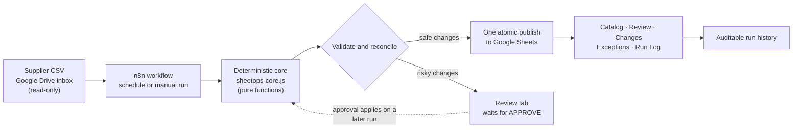
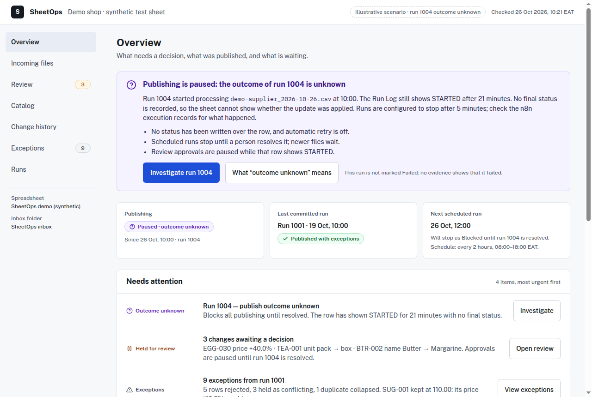
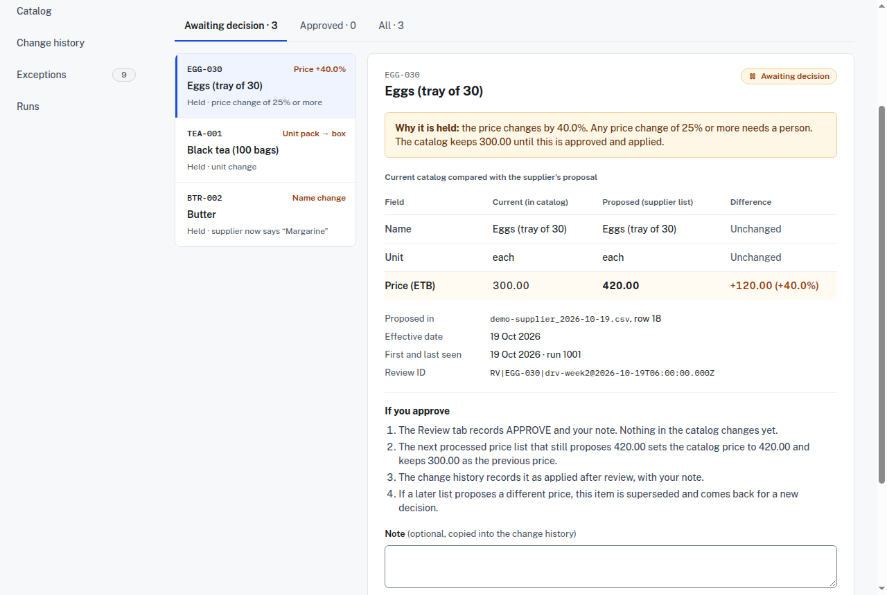
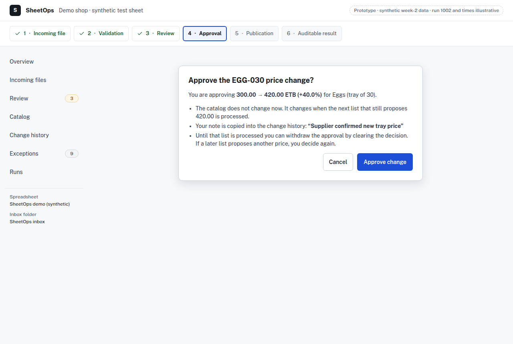
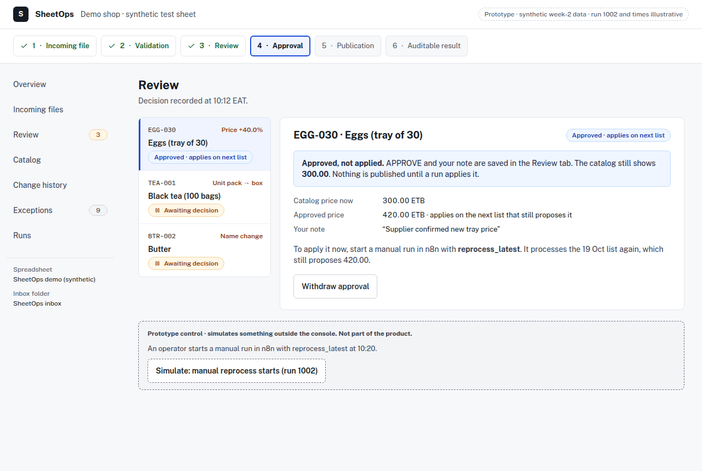
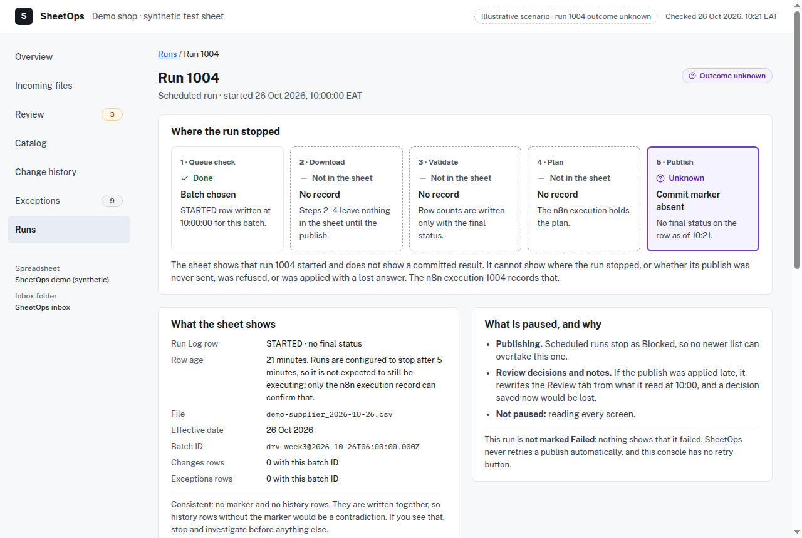
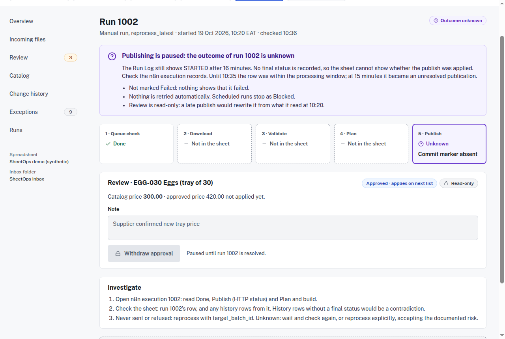
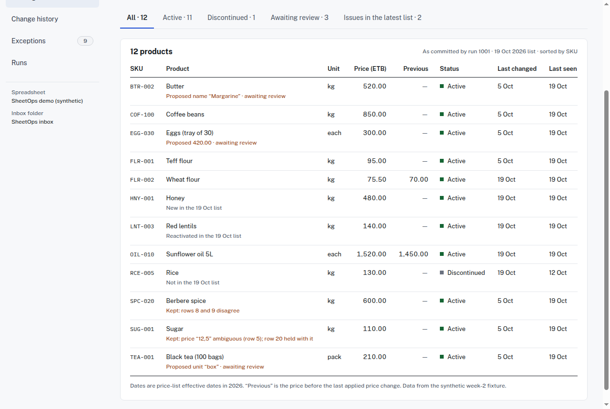
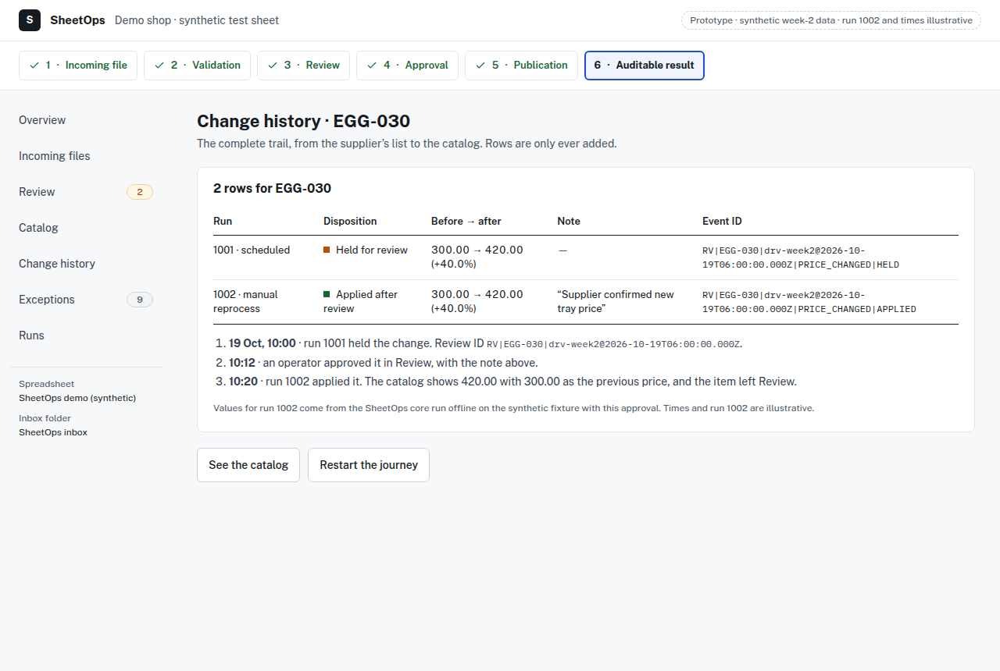

# SheetOps: a case study in safe supplier price-list automation

> **Status at a glance (5 November 2026).** The processing core and the n8n
> workflow are built and tested **offline**, and replayed in a real n8n engine
> with **recorded** Google responses. **Nothing has run against a real Google
> spreadsheet yet.** A read-only operator console now exists on **offline demo
> data**; the screenshots in this document show the earlier **design concept**,
> not that build. SheetOps is not production-ready. All data is synthetic; no
> business uses SheetOps today.

## 1. Executive summary

A business that buys from suppliers often receives a new price list every week
as a CSV file. Someone has to check it, update the product catalog, and notice
when something looks wrong. Done by hand, that work is slow and error-prone,
and the costly mistakes are the quiet ones: a price that jumped 40%, a product
that silently disappeared, an old file applied over a newer one.

SheetOps automates that weekly job for a catalog kept in Google Sheets. It
picks up each supplier file from a Google Drive folder, checks every row,
compares the list with the current catalog, applies the safe changes, **holds
the risky ones for a person to approve**, and records everything it did and
did not do. When it cannot be sure what happened, it says so and stops,
instead of guessing.

It runs on n8n. All business rules live in one dependency-free JavaScript file
that can be tested without n8n, Google or a network.

## 2. The problem and its constraints

**Who it is for.** A small retailer, wholesaler or distributor, or the
operations manager who maintains their product catalog in Google Sheets and
receives recurring price lists from a supplier.

**What goes wrong when the file is processed by hand.**

| Risk | What it looks like in practice |
|---|---|
| Invalid records and malformed files | A blank SKU, a negative price, a price in USD in an ETB catalog, a stray comma that shifts every column |
| Ambiguous values | `12,5`: is that 12.50 or 125? |
| Suspicious price changes | A 40% increase that may be a typo, or a real change nobody noticed |
| Conflicting duplicates | The same SKU twice with two different prices |
| Accidental discontinuation | A truncated export makes half the catalog "disappear" |
| Stale data | Last month's file uploaded again and applied over this week's prices |
| Lost review decisions | Someone's approval or note is overwritten by the next update |
| Uncertain publication | The update times out: did it reach the sheet or not? Applying it twice, or not at all, both cause damage |
| No audit trail | Nobody can say later what changed, when, from which file, or why |

**Why a generic "clean up the spreadsheet" workflow is not enough.** Most
automations treat each run as independent and assume the write succeeded.
SheetOps is built around four properties instead:

1. **Safe reconciliation.** The catalog only changes in documented,
   explainable ways; invalid input never deletes or discontinues anything.
2. **Deliberate human approval.** Risky changes wait for a person, and a
   recorded approval is not the same thing as an applied change.
3. **Recoverable operations.** Every run can be re-run without duplicating
   history.
4. **Honest failure reporting.** A failure is only called a failure when it
   provably is one. An unknown outcome stays "unknown" until someone resolves
   it.

**Bounded scope (version one).** One supplier and one spreadsheet. CSV only.
One currency (ETB). Up to 2,000 rows per file, 2,000 catalog rows and 50 files
in the inbox. APPROVE is the only review decision (there is no reject). There
is no frontend: operators work in the Google Sheet itself. (That remains the
version-one decision. A read-only console was later added as a deliberate scope
expansion; see section 6.)

## 3. Solution architecture

**Division of labour.** n8n moves data: it lists the inbox, downloads the
file, reads the spreadsheet, sends one publish request and reads back the
result. It never decides anything. Every decision (which file comes next, what
each row means, what is safe to apply, what the publish request contains, how
to interpret a failure) is made by `src/sheetops-core.js`. The core has no
clock, randomness, network or file access; time and file metadata are inputs.
The same input always produces the same output, which is what makes it
testable.

The importable workflow (`workflow/sheetops.workflow.json`) is generated from
the core by `workflow/build.js`. It has 33 nodes: a schedule (every two hours,
08:00–18:00) and a manual trigger, 7 Code nodes (6 embed the core), 12 HTTP
Request nodes for Google, an Extract From File node that passes the download's
exact bytes to the core, 6 Switch nodes, and a 20-second Wait used to
re-check an uncertain publish. It is exported **inactive** and contains no
credentials.

**The spreadsheet SheetOps maintains.**

| Tab | Purpose |
|---|---|
| **Catalog** | The current product list: committed prices only, with previous price and last issue |
| **Review** | Changes waiting for a person. The operator edits only the `decision` and `note` columns |
| **Changes** | Append-only history of every change: applied, held, applied after review, superseded |
| **Exceptions** | Append-only record of every row not applied as written, with the raw value and what SheetOps did |
| **Run Log** | One row per run, with counts that account for every input row and one authoritative final status |
| `_sheetops_version` (hidden) | One empty cell whose internal sheet ID acts as a version number; used to reject a publish planned from an outdated state |

## 4. Safety decisions, shown through four examples

All values come from the synthetic week-2 fixture
(`fixtures/week2/`, file `demo-supplier_2026-10-19.csv`). Its expected results
were written by hand from the rules **before** the code existed.

### Example A: human review, and why "approved" is not "applied"

A price change of **25% or more** is held for a person. The comparison is
done in whole cents, so 25.00% is held and 24.99% is applied.

- **EGG-030** (Eggs, tray of 30): 300.00 → 420.00, **+40.0%**. Held. The
  catalog keeps 300.00.
- **FLR-002** (Wheat flour): 70.00 → 75.50, **+7.9%**. No review rule applies,
  so it is applied automatically and recorded in Changes.

Unit changes (TEA-001: pack → box) and name changes (BTR-002: Butter →
Margarine) are always held, whatever the price.

Approving is deliberately **not** the same as changing the catalog. The
operator types `APPROVE` in the Review tab; that is a recorded decision. The
catalog changes only when a later run processes a list that **still proposes
the approved value**. That can be the next weekly list, or a manual reprocess
of the current one. The history then gains an `APPLIED_AFTER_REVIEW` row with
the operator's note. If the supplier's next list proposes a different price,
the old approval is superseded and the item comes back for a new decision.
The operator's decision and note are preserved on every run. Just before
publishing, SheetOps reads Review again. If a decision or note changed since
the plan was built, it publishes nothing and records `FAILED`
(`REVIEW_CHANGED`), leaving the edit in place for the next run. An edit saved
after that final read can still be lost; Google Sheets offers no conditional
write that could prevent it.

### Example B: a missing or broken product is not a discontinued product

- **SUG-001** (Sugar) appears twice in the file. Row 5 has the price `12,5`,
  which could mean 12.50 or 125, so it is rejected. Row 20 is valid but shares
  the SKU with a rejected row, so it is held. Neither is applied, **and SUG-001
  stays active at 110.00**: a product with any row in the file, even a rejected
  one, is present, and only absent products can be discontinued.
- **Mass-discontinuation stop.** If more than 30% of active products are
  absent, the run halts and changes nothing. The test is strict: **3 of 10
  absent (exactly 30%) proceeds; 4 of 10 halts.** Discontinuing them anyway
  needs an explicit manual run for that specific file.
- **Stale files.** A file older than the latest committed list is rejected as
  `OUT_OF_ORDER_FILE`, so last month's prices can never overwrite this week's.

### Example C: when the outcome of a publish is unknown

Every run writes its results through **one** Google Sheets `batchUpdate`
request. The request also overwrites the run's own Run Log row with its final
status (the "commit marker"), so data and status land together or not at
all. Google documents `batchUpdate` as atomic; the live tests will check it
on this sheet.

The hard case is a publish that gets **no clear answer**: a timeout, HTTP 408,
a 5xx server error, or a lost connection. Google may have applied the update,
may not have, or may still apply it later. SheetOps treats these as **unknown,
not failed**:

- It waits 20 seconds and re-reads its own Run Log row. If the final status is
  there, the publish applied.
- If the row still says `STARTED`, it **writes nothing**. Writing `FAILED`
  could overwrite a publish that lands a moment later. The n8n execution
  records `PUBLISH_OUTCOME_UNKNOWN`.
- **Automatic retry is off.** An unresolved row, 15 minutes or older, blocks
  all later publishing (`PUBLICATION_UNRESOLVED`), so a newer list cannot
  overtake the uncertain one.
- A person inspects the evidence (the n8n execution, the Run Log row, any
  history rows) and explicitly reprocesses that exact batch if appropriate.
  The setup guide documents the procedure, and the risk of reprocessing an
  outcome that is still unknown.

Only definitive failures are recorded as `FAILED`: a 4xx refusal other than
408, or a failure before anything was sent, and only after re-reading the
run's own row.

**The version check.** Every publish starts by deleting the hidden version tab
by its known ID and recreating it with a higher one. If another publish has
already applied, that ID no longer exists, Google rejects the whole request,
and nothing in it is applied. A late-arriving original can therefore not
overwrite a recovery. History rows are written at fixed positions, so an
identical replay adds no duplicate rows.

**What remains uncertain.** The check relies on Google's documented
validation plus one inference: that deleting a missing sheet ID counts as an
invalid request. Whether two publishes planned from the same version can both
apply when they arrive **at the same moment** is not documented at all. The
live tests T-VERSION-1 and T-VERSION-2 exist to establish it. Until they pass,
automatic recovery stays off by design.

### Example D: different tests prove different things

| Evidence | What it shows | What it does not show |
|---|---|---|
| Hand-calculated fixtures | The rules give the results a person would compute from the written contract | That the rules are complete |
| Offline unit and property tests | The core behaves as specified, including boundaries (25.00% vs 24.99%, 3/10 vs 4/10) and reruns | Anything about n8n or Google |
| Failure-path simulation | The whole workflow runs end to end against a fake Google, including 403, 503, timeouts, lost responses and late-landing publishes | That the fake behaves exactly like Google |
| Real n8n replay | The real n8n 2.41.7 engine produces the same node outputs and requests as the simulator, with recorded responses | Anything about live Google behaviour |
| Mutation testing | Deliberately introduced defects are caught by the tests | That untested behaviour is correct |
| Live Google tests | Atomicity, version check, lost-response handling on a real sheet | **Not run yet** |

## 5. Engineering evidence and its provenance

"Verified here" means re-run for this document, most recently on 5 November
2026, with Node.js v24.21.0. "Reported" means a result from earlier work that
was not re-run for this document.

| Claim | Result | Source | Status |
|---|---|---|---|
| M1 baseline (commit `4addaa1`) offline tests | 76 / 76 pass | `npm test` on a read-only export of the commit | **Verified here** |
| M2 commit (`eeac3a1`, branch `m2-frontend`, not merged) offline tests | 171 / 171 pass | `npm test`, 4 Nov | **Verified here** |
| With the later runner, audit and contract v2.6 changes | 252 / 252 pass, about 15 s | `npm test`, 5 Nov | **Verified here** |
| Operator console on demo data | 169 / 169 tests; typecheck and production build pass; browser check of 350 page loads at five widths with no overflow or console errors | `frontend/`, 5 Nov | **Verified here; offline only** |
| End-to-end simulator scenarios | 31 | Counted in `test/simulate.test.js`; included in the root suite | **Verified here** |
| Real n8n 2.41.7 replay | 16 / 16 scenarios match the simulator node for node; the production workflow (33 nodes) survives an import/export round trip | `npm run verify:n8n` (recorded responses, no Google, about 6 minutes on 5 Nov), which also passes its built-in checks | **Verified here** |
| Mass-discontinuation boundary | 3/10 proceeds, 4/10 halts | `test/safety.test.js`, part of the root suite | **Verified here** |
| Mutation testing | 40 / 40 defects caught; unmutated control passes | Earlier run of a script kept outside the repository | **Reported, not reproduced.** A reconstructed copy of the script has known defects and has not been accepted |
| Mutation check | 35 / 35 selected defects caught, on 5 Nov | `scripts/mutation/run.js`; a selected list, not a measure of coverage | **Verified here; offline only** |
| Live Google Sheets / Drive tests | — | `scripts/live/run-live-tests.js`, plan in `docs/setup.md` §5 | **Not run** |

The README and `docs/requirements.md` (FR-015) state the same scenario counts:
16 replay scenarios and 31 simulator scenarios. All of this is offline or
simulated evidence, not proof of live Google integration.

## 6. UI/UX design concept

**What it is.** A separately designed operator console, published as a design
canvas with an interactive prototype (version 16, artifact version ID
`1793131375-cbca`). It explores how an operator would see and act on what
SheetOps does. **This design is not the product**: in version one, operators use
the Google Sheet directly. A read-only console was later built from a newer design
version as a deliberate scope expansion (`frontend/`): Overview, Runs, Run details,
Review, Exceptions, Incoming files (recorded files only), Catalog, Change history and
Connection, on offline demo data. It has no approval controls, no view of the live
Drive inbox and no live Google data. The
screenshots below come from the version-16 design, not from that build. The canvas is **private** to its owner. Until a
deliberate decision is made to share it, show the screenshots below, or walk
through the prototype live on a call.

**Layout.**

- **Triage** is the primary layout: a sidebar and a "needs attention" list
  ordered by urgency. Most weeks the operator's real question is "is anything
  waiting for me, and is anything wrong?"
- **Ledger-style tables** are used for Catalog, Change history and Exceptions:
  dense, ruled, monospaced IDs and right-aligned numbers. These are reference
  screens, and an operator scans them like a ledger.
- A **five-stage track** (queue check, download, validate, plan, publish)
  appears only on run details, where it explains where a run stopped. For an
  unknown outcome it shows steps 2–4 as "not in the sheet" rather than
  pretending to know.

**How states are kept distinct.**

| State | Presentation | Why |
|---|---|---|
| Proposed / held | Amber "Awaiting decision" | Needs a person |
| Approved | **Blue** "Approved · applies on next list" | A recorded decision, not a change; never shown in the price column |
| Committed | Green "Published" | The publish applied |
| Failed | Red, with the Run Log's HTTP message | Only for definitive failures |
| Halted, blocked | Amber, with the reason code | Needs a decision before the queue moves |
| Unknown | **Violet** "Outcome unknown", "Not marked Failed" | A different situation from failure, with different actions |

An unknown outcome **never** gets a retry button. Retrying blindly is exactly
the action that could apply a change twice; the screen offers an investigation
checklist instead. While any run shows `STARTED`, review decisions and notes
are locked, and the lock explains itself.

**Accessibility and responsive behaviour.** Earlier rounds of work on this
design produced the following. Unless marked, these results were not re-run
for this document.

| Check | Result | Status |
|---|---|---|
| Prototype regression (journey, focus, labels, all four publication outcomes) | 78 / 78 | Measured on the version-16 files before publishing, in the canvas runtime outside Claude's Play view |
| Layout at 320, 375, 768 and 1280 px | 36 / 36 combinations without overflow or hidden content | As above |
| Text contrast (WCAG 2.2 AA) | All text 4.5:1 or better; lowest 6.01:1 | Measured on rendered pages; form-field borders raised to 3.5:1 or better |
| Screen reader (Orca 46.1, isolated session) | Dialog announced with its purpose; nav counts named ("Review, 3 awaiting a decision"); comparison table navigable with headers; every outcome announced, including "Not marked failed" | Captured as the text Orca submitted for speech; no audio was played |

**Open accessibility limitations.**

- **Escape after reading:** Escape closes the approval dialog while focus is
  in it. After reading the dialog with the arrow keys, focus moves to the page
  body and Escape no longer works until Tab returns to a button.
- **Run-together speech:** some side-by-side content is read as one string,
  for example "PublishingPaused · outcome unknown".
- **Screen-change headings:** headings after a screen change are announced
  inconsistently; outcome messages are announced reliably.
- **Not verified:** audible speech, screen readers other than Orca, browsers
  other than Chrome, and the prototype inside Claude's embedded Play view.

**Screenshots.** Captured on 27 October 2026 from the published version-16
board files (artifact version `1793131375-cbca`), rendered by the canvas's own
runtime in headless Chrome 154 at 1280 px. They were **not** captured inside
Claude's embedded Play view. Times, run 1002 and scenario labels are
illustrative; product data is the synthetic fixture.

| Image | What it shows |
|---|---|
|  | **Overview.** Publishing paused because run 1004's outcome is unknown; stated from Run Log evidence and "not marked Failed" |
|  | **Review.** Why EGG-030 is held (+40.0%), current versus proposed values, and what approving will and will not do |
|  | **Confirmation.** The catalog does not change now; the note goes into the history; the approval can be withdrawn |
|  | **Approved ≠ committed.** Blue "Approved", catalog still 300.00, and how the change will actually be applied |
|  | **Investigation.** The stage track shows only what the sheet can prove; spreadsheet and n8n evidence are kept separate |
|  | **Unknown outcome.** No retry button, review locked with its reason, investigation steps |
|  | **Catalog ledger.** Committed prices only; held proposals appear as labelled notes, never in the price column |
|  | **Audit trail.** Held in run 1001, approved with a note, applied after review in run 1002 |

## 7. Limitations and current status

| Area | Status |
|---|---|
| Deterministic core (M1) | Implemented; committed (`4addaa1`) |
| n8n workflow, simulator, replay, live-test harness (M2) | Implemented and tested offline; committed on `m2-frontend`, **not merged** to `main` |
| Live Google Sheets and Drive behaviour | **Untested**: atomicity, the version check, lost responses and credentials have not touched a real spreadsheet |
| Concurrent publishes | Undocumented by Google; covered only by a planned live test (T-VERSION-2) |
| Review edits during a run | Since contract v2.5 a final Review read just before the publish aborts the run (`FAILED`, `REVIEW_CHANGED`) if any decision or note changed. An edit saved after that final read can still be lost (Google Sheets has no conditional write); the item then shows its earlier decision and nothing is applied |
| Operator console | Read-only build tested on offline demo data (169 / 169). The live Drive inbox and live data not implemented. Approval remains design only |
| Manual synthetic workflow run | **Not established**. The current workflow must be imported first |
| Typed-decision and strict-encoding checks | Implemented and tested offline and in replay; **real Google responses not observed** (T-FORMULA, T-ENCODING) |
| Google credential and workflow settings | **Not verified as configured**: when last read on 4 November, n8n's database held no credential and no executions |
| Synthetic spreadsheet, inbox and sharing | **Reported by the owner; not independently verified** |
| Failure drills and handover documentation (M3) | Not started |

## 8. Next milestones

1. **Live verification on a dedicated synthetic spreadsheet**, following
   `docs/setup.md` §5: T-UI, T-LIVE-1, T-ATOM-1, T-ATOM-2, T-SEC-1,
   T-VERSION-1, T-VERSION-2, T-LOST-A and T-LOST-B.
2. **Decide on automatic recovery** from the T-VERSION results; it stays off
   unless both pass.
3. **Failure drills (M3):** practise the documented recovery procedures
   end to end, then write the handover documentation.
4. **Before the live run**, work through `docs/live-readiness-checklist.md`.

## 9. Freelance relevance

The work demonstrates skills that transfer directly to client projects:

- **n8n workflows that can be trusted with business data**: explicit retry
  policy, bounded timeouts, no secrets in exports, every failure route tested.
- **Google Sheets and Drive automation** using the APIs directly, including
  atomic multi-tab updates and safe re-runs.
- **Data validation and reconciliation** for supplier feeds, price lists,
  inventory and other recurring CSV imports.
- **Human-in-the-loop approval** built into a spreadsheet the client already
  uses.
- **Honest failure handling and audit trails** for processes where a wrong
  write costs real money.
- **Test strategy** that makes clear what has and has not been proven.
- **Operator-facing design** that explains system state to non-technical
  staff.

## 10. Demonstration walkthrough

This walkthrough is reproducible offline today. Steps 5 and 6 are explicitly
**not** live.

1. **The file.** Open `fixtures/week2/demo-supplier_2026-10-19.csv`: 19 rows
   with deliberate problems (an ambiguous price, a negative price, a USD row,
   duplicates, a blank SKU, a 40% increase).
2. **The expected result, by hand.** `fixtures/README.md` gives every row's
   outcome and the arithmetic. 19 rows = 6 accepted + 1 collapsed + 5
   rejected + 3 held as conflicting + 3 held for review + 1 blank.
3. **Run the tests.** `npm test` (no installation, no network): all pass (252
   on 5 November), including the exact match with the hand-calculated catalog, changes,
   exceptions and run row.
4. **Approve and apply.** The tests show EGG-030 held at 300.00, approved, then
   applied at 420.00 by a later run, with an `APPLIED_AFTER_REVIEW` history
   row carrying the note.
5. **Break the publish.** The simulator runs the same workflow with a 403
   (recorded as `FAILED`, nothing applied), a 503 (unknown, nothing written,
   later runs blocked) and a publish that lands late (row and data agree).
   These use a fake Google.
6. **Replay in real n8n.** `npm run verify:n8n` replays 16 scenarios in n8n
   2.41.7 with recorded responses.
7. **Show the operator's view.** Open the read-only console in `frontend/` on its
   demo scenarios, or walk through the design prototype: incoming file →
   validation → review → approval (blue, catalog still 300.00) → publication
   (choose applied, refused or unknown) → audit trail.
8. **End honestly.** The result is verified offline and in replay. Whether
   Google enforces the version check under concurrency is **explicitly
   unresolved** until the live tests run.
